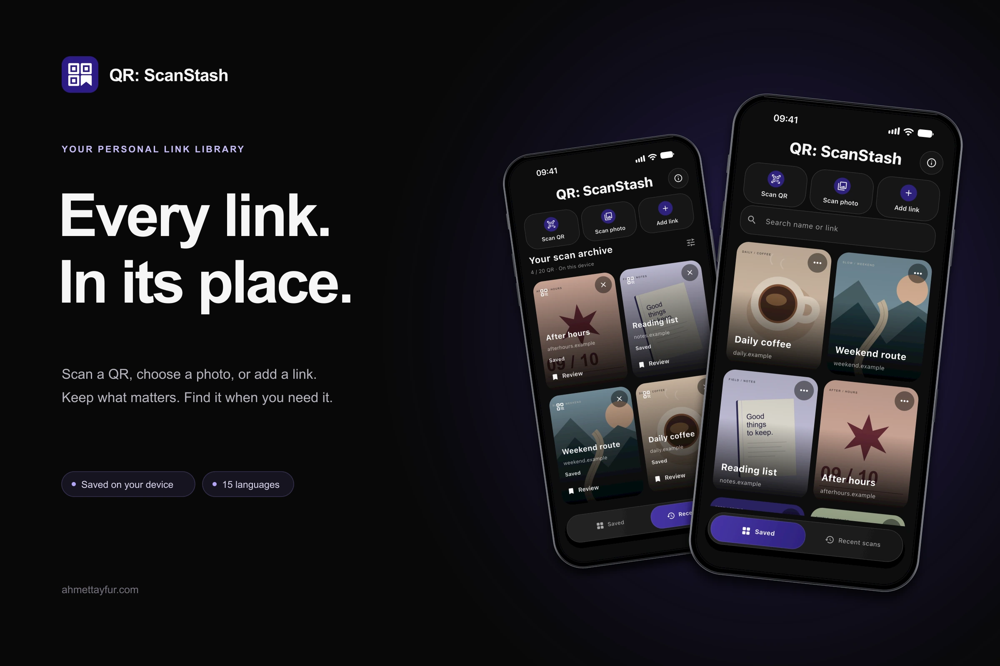
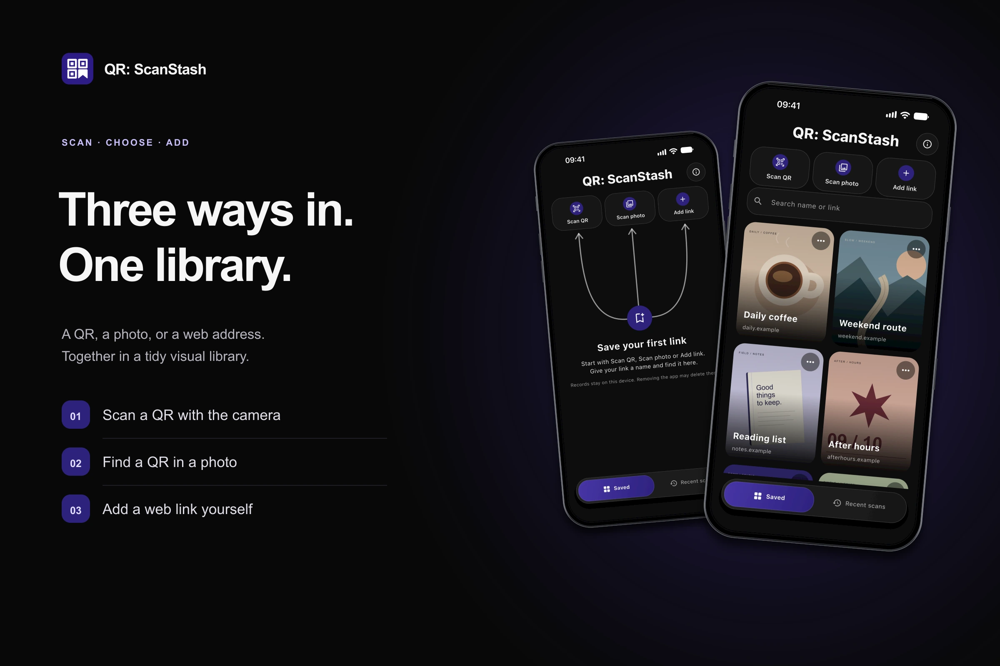
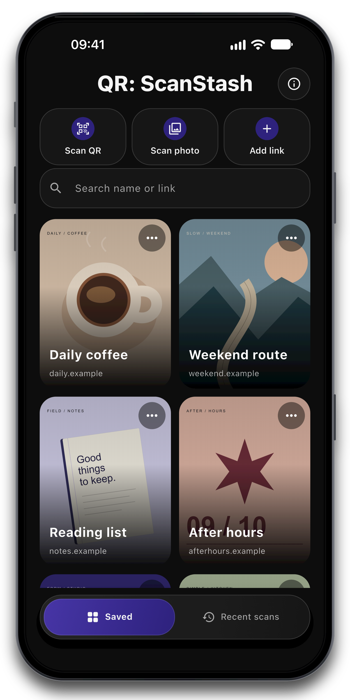
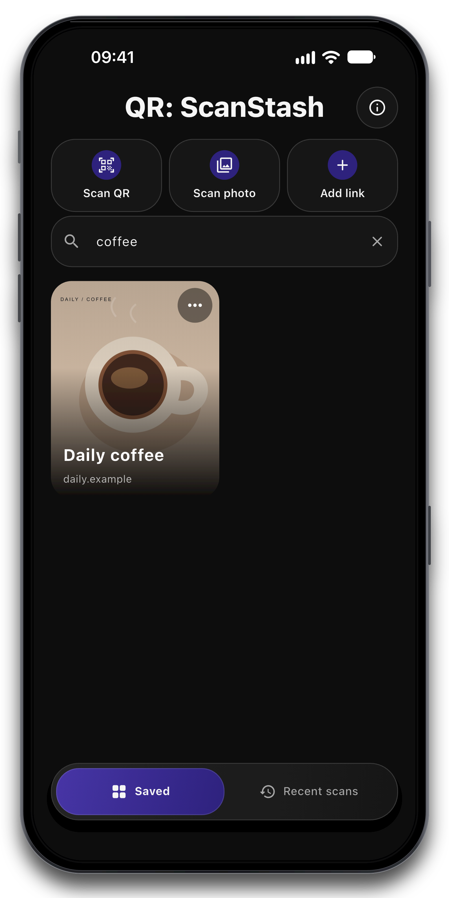
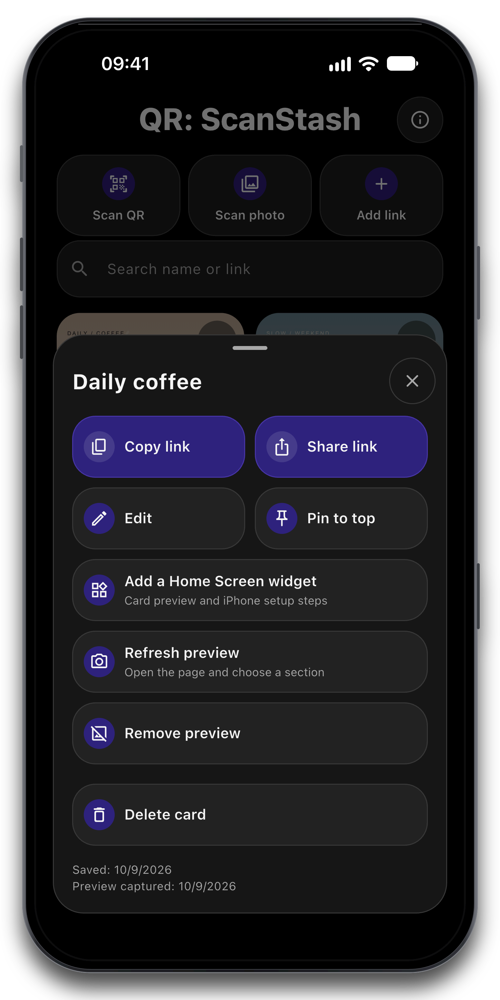

# QR: ScanStash

A visual link library for iPhone. Scan a QR code, save a link in your own words, and find it again by its title or preview.

**[English](README.md) · [Türkçe](README.tr.md)**

**iPhone only · iOS 17+ · 15 languages · Preparing for release**

## Why I built it

A QR code can take you to a cafe menu or a useful page in seconds. Finding that page again is harder when the tab is gone and the domain does not describe what you remember. ScanStash keeps the link under a name you choose, with an optional visual preview to help you recognize it later.

## What the app does

- **Three direct entry points:** scan with the camera, read a QR from a selected photo, or type a domain such as `google.com`.
- **Save from Safari:** use the iOS share extension and give the link a memorable title.
- **Build a visual library:** rename, edit, pin and delete cards; optionally capture the visible part of a page as a local preview.
- **Find a saved link:** search by title, domain or URL, including tolerant matching for Turkish characters.
- **Revisit recent scans:** keep the last 20 distinct QR results, with controls to disable or clear history.
- **Copy or share:** send the complete URL through the clipboard or iOS share sheet, preserving its query and fragment.
- **Use a Home Screen widget:** choose one saved card and open its current link directly from a small WidgetKit widget.

QR detection offers a choice to open or save. A photo with multiple QR results lets you choose the relevant content. Non-web QR content can be reviewed and copied.

## Product screens

<table>
  <tr>
    <td align="center"></td>
    <td align="center"></td>
    <td align="center"></td>
  </tr>
  <tr>
    <td align="center">Saved library</td>
    <td align="center">Local search</td>
    <td align="center">Card actions</td>
  </tr>
</table>

Screens show the current app captured in an iPhone 18 Pro Max simulator and placed in original illustrative device frames. The `.example` links and preview artwork are fictional demo content. These are simulator screenshots, rather than physical-device photographs.

## Design and engineering

The app uses a black background, white typography and a purple accent. Its two main pages share aligned empty-state guidance, direct intake actions and simple horizontal transitions. Layouts adapt to larger text and right-to-left languages; reduced-motion and screen-reader settings skip the opening and page animations.

| Layer | Approach |
|---|---|
| App interface | Flutter, with domain policies independent of platform and database packages |
| Local storage | SQLite for cards and QR history; local JPEGs for optional previews |
| iPhone integrations | Swift camera/photo QR handling, Safari Share Extension, WebKit and WidgetKit |
| Widget navigation | Stable card ID resolves the current URL in the main app |
| Localization | Shared Flutter/native catalog, 15 languages, device-language selection and English fallback |

Supported languages: English, Turkish, German, French, Spanish, Italian, Brazilian Portuguese, Polish, Russian, Arabic, Hindi, Indonesian, Japanese, Korean and Simplified Chinese.

## Privacy and project status

Saved content is kept locally. There is no account system, application backend, analytics SDK, advertising or payment implementation. Reading a photo uses Apple's selected-photo picker and does not request access to the entire photo library. Opening a website connects to that website; system sharing and backups follow the device's settings.

The first release is planned to be free. The app is preparing for distribution and is **not yet available on the App Store or TestFlight**. As of October 9, 2026, 121 Flutter tests and 16 Swift host tests passed, with clean static analysis and a successful iOS simulator build. Detailed release acceptance and distribution validation remain separate.

This repository is a **public product portfolio**, containing selected documentation and approved visuals. The application implementation and its development history are maintained privately.

[Website](https://ahmettayfur.com/products/) · [Support](https://ahmettayfur.com/products/scanstash/support/) · [Privacy](https://ahmettayfur.com/products/scanstash/privacy/) · [Terms](https://ahmettayfur.com/products/scanstash/terms/)

© 2026 Ahmet Tayfur. All rights reserved.
