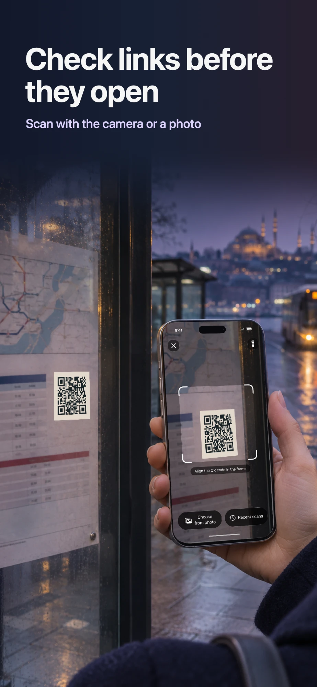
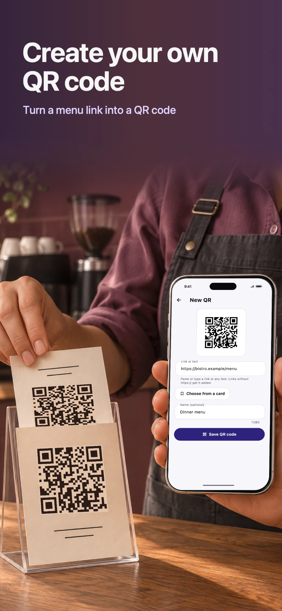
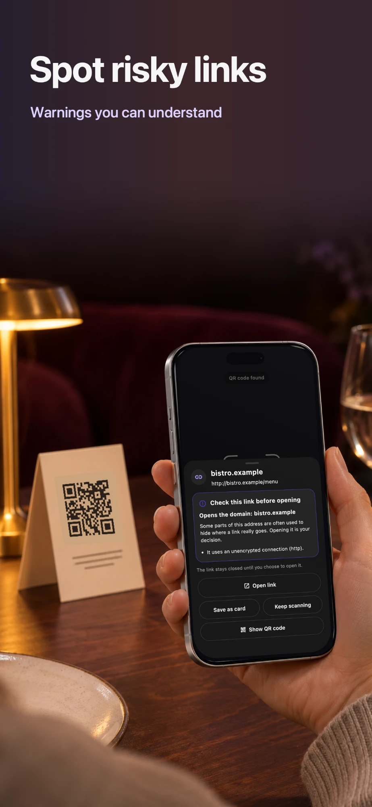
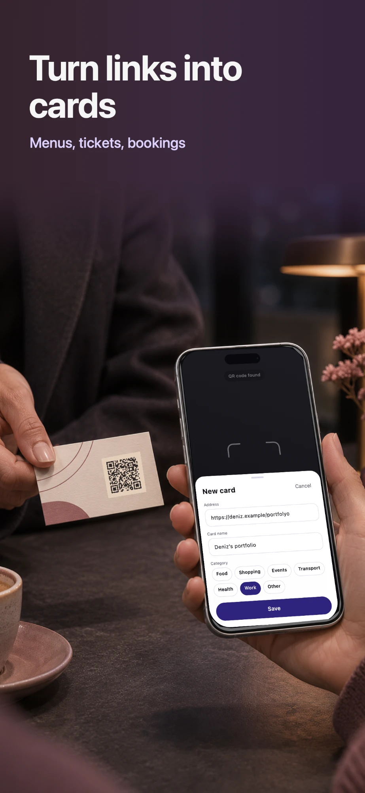
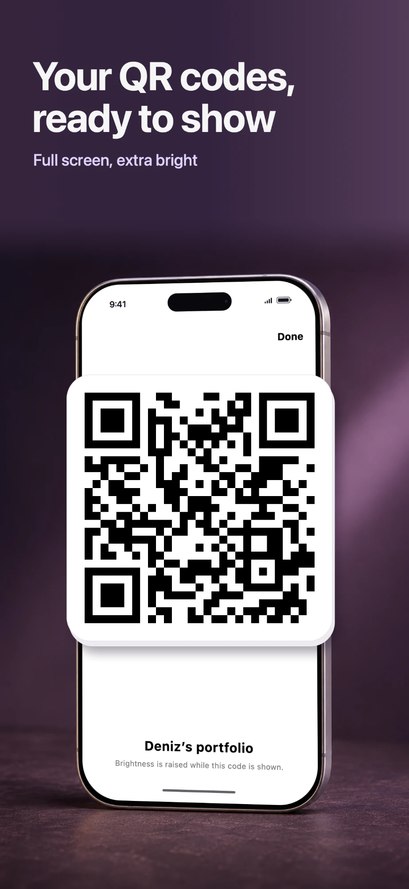

# QR: ScanStash

**Safe scanner & link cards for iPhone.** Scan a QR code with the camera or from a photo, see where the link goes before anything opens, and keep the links you want as visual cards.

**[English](README.md) · [Türkçe](README.tr.md)**

**iPhone · 15 languages · Free + Pro (yearly or lifetime) · [Live on the App Store](https://apps.apple.com/app/id6820834276)**

<table>
  <tr>
    <td align="center"></td>
    <td align="center"></td>
    <td align="center"></td>
    <td align="center"></td>
    <td align="center"></td>
  </tr>
  <tr>
    <td align="center">Scan</td>
    <td align="center">Create a QR code</td>
    <td align="center">Link warnings</td>
    <td align="center">Link cards</td>
    <td align="center">Show a QR code</td>
  </tr>
</table>

App Store images for version 1.1. The `.example` links are demo content.

## Why I built it

A QR code can take you to a cafe menu or a useful page in seconds. Finding that page again is harder when the tab is gone and the domain does not describe what you remember. ScanStash keeps the link under a name you choose, with an optional visual preview to help you recognize it later.

## What the app does

- **Check links before they open:** see the address before a QR code opens anything. Link shorteners and unencrypted (http) links get a safety warning, and nothing opens until you choose to open it.
- **Three direct entry points:** scan with the camera, read a QR from a selected photo, or type a domain such as `google.com`.
- **Turn links into visual cards:** categories, your own categories, favorites and search by title, domain or URL, including tolerant matching for Turkish characters.
- **Save in one tap:** a link on the clipboard becomes a card in one tap, or save straight from the Share menu in Safari.
- **Create your own QR codes:** from a link or any text, and show them full screen with the brightness raised.
- **Revisit recent scans:** with controls to disable or clear history.
- **Copy or share:** send the complete URL through the clipboard or iOS share sheet, preserving its query and fragment.
- **Use a Home Screen widget:** choose one saved card and open its current link directly from a small WidgetKit widget.
- **Light and dark:** the whole app comes in a light and a dark theme.
- **Apple Intelligence suggestions:** on supported iPhones, a title and a category are suggested on the device.

QR detection offers a choice to open or save. A photo with multiple QR results lets you choose the relevant content. Non-web QR content can be reviewed and copied.

## Free and Pro

- **Always free:** scanning with the camera and from photos, and the link safety warnings.
- **Free version:** 2 cards, 2 QR codes, 2 favorites and your last 2 scans.
- **Pro removes every limit:** Pro Yearly, with a 3-day free trial for eligible new subscribers, or Pro Lifetime, a one-time purchase. Prices are set per country by the App Store.

## Design and engineering

Version 1.1 brings a new design with light and dark themes. Layouts adapt to larger text and right-to-left languages; reduced-motion and screen-reader settings skip the opening and page animations.

| Layer | Approach |
|---|---|
| App interface | Flutter, with domain policies independent of platform and database packages |
| Local storage | SQLite for cards and QR history; local JPEGs for optional previews |
| iPhone integrations | Swift camera/photo QR handling, Safari Share Extension, WebKit and WidgetKit |
| Widget navigation | Stable card ID resolves the current URL in the main app |
| Purchases | StoreKit 2: Pro Yearly or Pro Lifetime |
| Suggestions | Apple Foundation Models, on the device (Apple Intelligence on supported iPhones) |
| Localization | Shared Flutter/native catalog, 15 languages, device-language selection and English fallback |

Supported languages: English, Turkish, German, French, Spanish, Italian, Brazilian Portuguese, Polish, Russian, Arabic, Hindi, Indonesian, Japanese, Korean and Simplified Chinese.

## Privacy and project status

There is no account, your data stays on the device and there are no analytics. There is no application backend or advertising. Pro purchases use Apple StoreKit 2; card content is not included in purchase requests. Reading a photo uses Apple's selected-photo picker and does not request access to the entire photo library. Opening a website connects to that website; system sharing and backups follow the device's settings.

Live on the App Store since 6 November 2026. Version 1.1 (November 2026): new design, light & dark, QR codes, link safety warnings, Pro yearly or lifetime.

This repository is a **public product portfolio**, containing selected documentation and approved visuals. The application implementation and its development history are maintained privately.

[App Store](https://apps.apple.com/app/id6820834276) · [Product page](https://ahmettayfur.com/products/scanstash/) · [Support](https://ahmettayfur.com/products/scanstash/support/) · [Privacy](https://ahmettayfur.com/products/scanstash/privacy/) · [Terms](https://ahmettayfur.com/products/scanstash/terms/)

© 2026 Ahmet Tayfur. All rights reserved.
