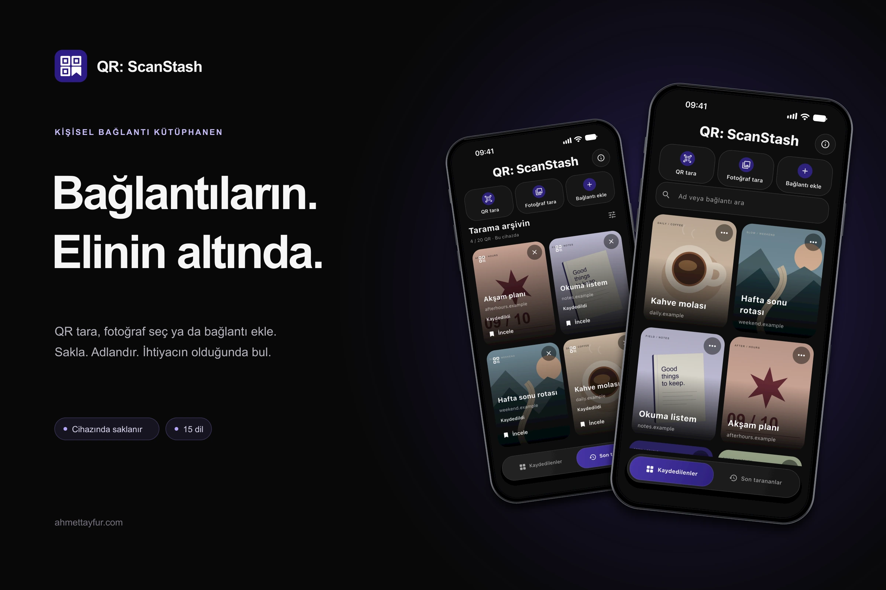
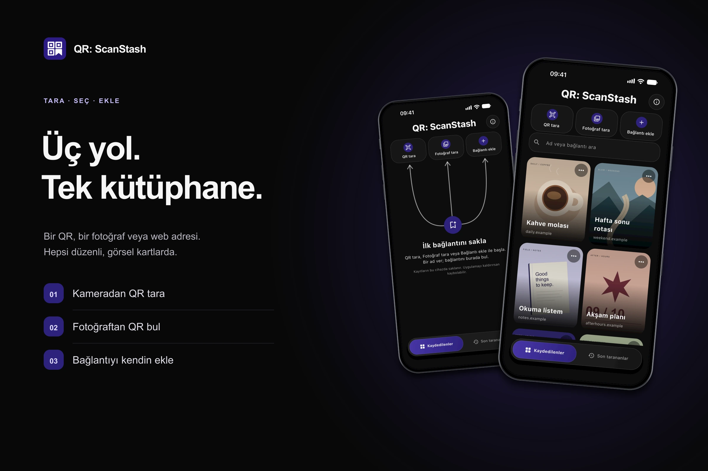
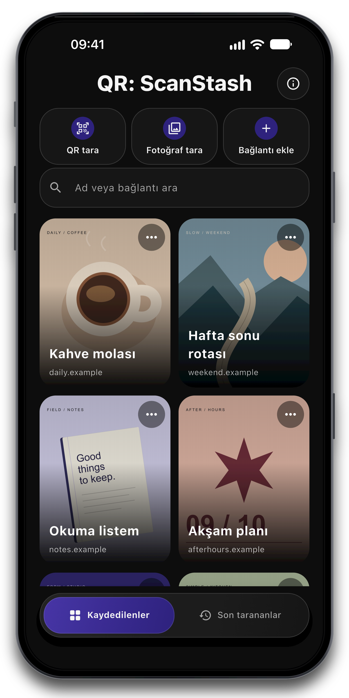
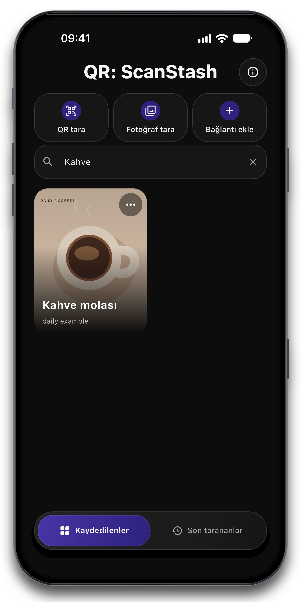
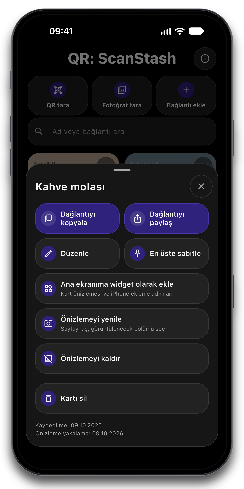

# QR: ScanStash

iPhone için görsel bağlantı kütüphanesi. QR kodunu tara, bağlantını kendi verdiğin adla sakla ve daha sonra adıyla ya da önizlemesiyle yeniden bul.

**[English](README.md) · [Türkçe](README.tr.md)**

**Yalnız iPhone · iOS 17+ · 15 dil · Yayın hazırlığında**

## Bu ürünü neden geliştirdim?

QR kodu bir kafe menüsüne veya yararlı bir sayfaya birkaç saniyede götürebilir. Sekme kapandığında ve alan adı hatırladığın şeyi anlatmadığında o sayfayı yeniden bulmak zorlaşır. ScanStash, bağlantıyı senin seçtiğin adla ve daha sonra tanımana yardımcı olacak isteğe bağlı görsel önizlemeyle saklar.

## Uygulama neler yapıyor?

- **Üç doğrudan giriş:** kameradan QR tara, seçilen fotoğraftan QR çöz veya `google.com` gibi bir domain yaz.
- **Safari'den kaydet:** iOS paylaşım uzantısından bağlantıya hatırlayacağın bir ad ver.
- **Görsel kütüphane oluştur:** kartları adlandır, düzenle, sabitle veya sil; istersen sayfanın görünür bölümünü yerel önizleme olarak sakla.
- **Kaydettiğin bağlantıyı bul:** ad, domain veya URL içinde ara; Türkçe harf farklılıkları tolere edilir.
- **Son taramalara dön:** son 20 farklı QR sonucu; geçmişi kapatma ve temizleme seçenekleri.
- **Kopyala veya paylaş:** query ve fragment bölümleri korunarak tam URL'yi panoya ya da iOS paylaşım ekranına gönder.
- **Ana Ekran widget'ını kullan:** tek kart seç ve küçük WidgetKit widget'ından kartın güncel bağlantısını aç.

QR algılandığında gitme veya kaydetme seçimini kullanıcı yapar. Birden fazla QR içeren fotoğrafta ilgili içerik seçilir. Web bağlantısı olmayan QR içerikleri incelenebilir ve kopyalanabilir.

## Ürün ekranları

<table>
  <tr>
    <td align="center"></td>
    <td align="center"></td>
    <td align="center"></td>
  </tr>
  <tr>
    <td align="center">Kaydedilenler</td>
    <td align="center">Yerel arama</td>
    <td align="center">Kart seçenekleri</td>
  </tr>
</table>

Ekranlar mevcut uygulamadan iPhone 18 Pro Max simülatöründe çekildi ve özgün cihaz çizimleriyle çerçevelendi. `.example` adresleri ve önizleme çizimleri kurgusal demo içeriktir. Bunlar simülatör ekran görüntüleridir.

## Tasarım ve geliştirme

Siyah zemin, beyaz metin ve mor vurgu kullanılır. İki ana sayfa aynı hizadaki boş ekran rehberlerini, doğrudan giriş düğmelerini ve temel yatay geçişleri paylaşır. Büyük yazı ve sağdan sola dillerde düzen uyarlanır; Hareketi Azalt veya ekran okuyucu etkinse açılış ve sayfa animasyonları atlanır.

| Katman | Yaklaşım |
|---|---|
| Uygulama arayüzü | Flutter; platform ve veritabanı paketlerinden bağımsız domain politikaları |
| Yerel veri | Kartlar/QR geçmişi için SQLite; isteğe bağlı önizlemeler için yerel JPEG |
| iPhone entegrasyonları | Swift kamera/fotoğraf QR, Safari paylaşım uzantısı, WebKit ve WidgetKit |
| Widget gezinmesi | Sabit kart kimliğinden ana uygulamada güncel URL çözümü |
| Yerelleştirme | Ortak Flutter/native katalog, 15 dil, cihaz dili ve İngilizce fallback |

Desteklenen diller: Türkçe, İngilizce, Almanca, Fransızca, İspanyolca, İtalyanca, Brezilya Portekizcesi, Lehçe, Rusça, Arapça, Hintçe, Endonezce, Japonca, Korece ve Basitleştirilmiş Çince.

## Gizlilik ve proje durumu

Kaydedilen içerikler yerelde tutulur. Hesap sistemi, uygulama backend'i, analitik SDK, reklam veya ödeme uygulaması yoktur. Fotoğraf taraması Apple'ın seçilen fotoğraf akışını kullanır ve tüm galeriye erişim istemez. Web sayfası açıldığında ilgili siteye bağlantı yapılır; paylaşım ve yedekleme cihazın ayarlarına bağlıdır.

İlk sürüm ücretsiz planlanmıştır. Uygulama yayın hazırlığında; **henüz App Store veya TestFlight'ta dağıtılmadı**. 9 Ekim 2026 kontrolünde 121 Flutter ve 16 Swift host testi, temiz analiz ve iOS simülatör derlemesi geçti. Ayrıntılı yayın kabulü ve dağıtım doğrulaması ayrı kalan işlerdir.

Bu depo, seçilmiş belgeler ve onaylı görseller içeren **public ürün portföyüdür**. Uygulamanın kaynak kodu ve geliştirme geçmişi private tutulur.

[Web sitesi](https://ahmettayfur.com/products/) · [Destek](https://ahmettayfur.com/tr/products/scanstash/support/) · [Gizlilik](https://ahmettayfur.com/tr/products/scanstash/privacy/) · [Kullanım Koşulları](https://ahmettayfur.com/tr/products/scanstash/terms/)

© 2026 Ahmet Tayfur. Tüm hakları saklıdır.
