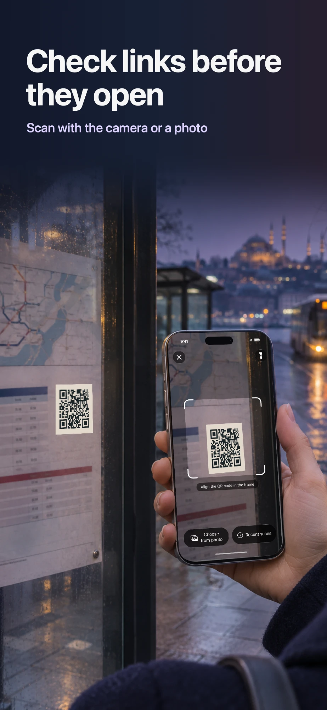
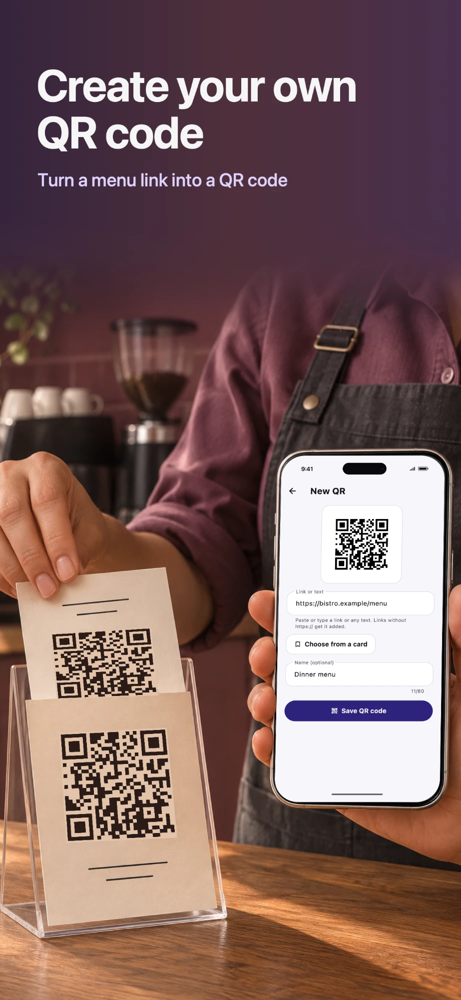
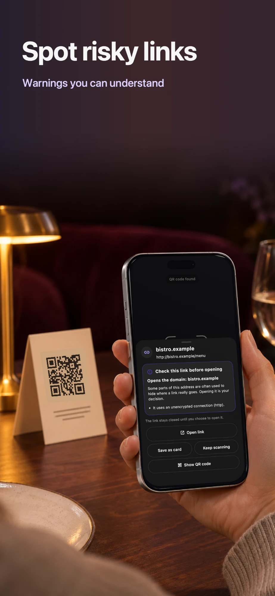
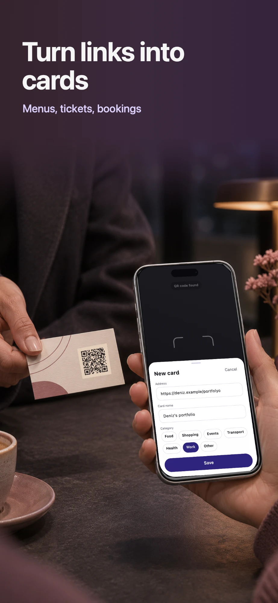
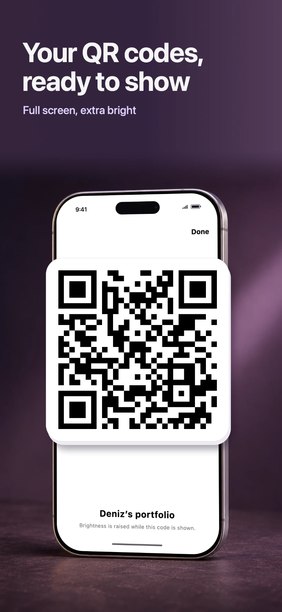

# QR: ScanStash

**iPhone için güvenli tarama, link kartları.** QR kodunu kamerayla veya fotoğraftan tara, bir şey açılmadan önce linkin nereye gittiğini gör ve saklamak istediğin linkleri görsel kartlara dönüştür.

**[English](README.md) · [Türkçe](README.tr.md)**

**iPhone · 15 dil · Ücretsiz + Pro (yıllık veya ömür boyu) · [App Store'da yayında](https://apps.apple.com/app/id6820834276)**

<table>
  <tr>
    <td align="center"></td>
    <td align="center"></td>
    <td align="center"></td>
    <td align="center"></td>
    <td align="center"></td>
  </tr>
  <tr>
    <td align="center">Tarama</td>
    <td align="center">QR kodu oluşturma</td>
    <td align="center">Link uyarıları</td>
    <td align="center">Link kartları</td>
    <td align="center">QR kodu gösterme</td>
  </tr>
</table>

1.1 sürümünün App Store görselleri (İngilizce). `.example` adresleri demo içeriktir.

## Bu ürünü neden geliştirdim?

QR kodu bir kafe menüsüne veya yararlı bir sayfaya birkaç saniyede götürebilir. Sekme kapandığında ve alan adı hatırladığın şeyi anlatmadığında o sayfayı yeniden bulmak zorlaşır. ScanStash, bağlantıyı senin seçtiğin adla ve daha sonra tanımana yardımcı olacak isteğe bağlı görsel önizlemeyle saklar.

## Uygulama neler yapıyor?

- **Açılmadan önce kontrol et:** QR kod bir şey açmadan önce adresi gör. Link kısaltıcılar ve şifresiz (http) bağlantılar için güvenlik uyarısı çıkar; sen açmadan hiçbir şey açılmaz.
- **Üç doğrudan giriş:** kameradan QR tara, seçilen fotoğraftan QR çöz veya `google.com` gibi bir domain yaz.
- **Linkleri görsel kartlara dönüştür:** kategoriler, kendi kategorilerin, favoriler ve ad, domain veya URL içinde arama; Türkçe harf farklılıkları tolere edilir.
- **Tek dokunuşla kaydet:** panodaki link tek dokunuşla karta dönüşür; Safari'nin Paylaş menüsünden de doğrudan kaydedebilirsin.
- **Kendi QR kodlarını oluştur:** bir linkten veya herhangi bir metinden; tam ekran ve yüksek parlaklıkla göster.
- **Son taramalara dön:** geçmişi kapatma ve temizleme seçenekleriyle.
- **Kopyala veya paylaş:** query ve fragment bölümleri korunarak tam URL'yi panoya ya da iOS paylaşım ekranına gönder.
- **Ana Ekran widget'ını kullan:** tek kart seç ve küçük WidgetKit widget'ından kartın güncel bağlantısını aç.
- **Açık ve koyu tema:** uygulamanın tamamı açık ve koyu temayla gelir.
- **Apple Intelligence önerileri:** desteklenen iPhone'larda başlık ve kategori cihaz üzerinde önerilir.

QR algılandığında gitme veya kaydetme seçimini kullanıcı yapar. Birden fazla QR içeren fotoğrafta ilgili içerik seçilir. Web bağlantısı olmayan QR içerikleri incelenebilir ve kopyalanabilir.

## Ücretsiz ve Pro

- **Her zaman ücretsiz:** kamerayla ve fotoğraftan tarama ile link güvenlik uyarıları.
- **Ücretsiz sürüm:** 2 kart, 2 QR kodu, 2 favori ve son 2 tarama.
- **Pro tüm sınırları kaldırır:** uygun yeni abonelere 3 gün ücretsiz denemeli Pro Yıllık ya da tek seferlik Pro Ömür Boyu. Fiyatları App Store ülkeye göre belirler.

## Tasarım ve geliştirme

1.1 sürümü açık ve koyu temalı yeni bir tasarımla gelir. Büyük yazı ve sağdan sola dillerde düzen uyarlanır; Hareketi Azalt veya ekran okuyucu etkinse açılış ve sayfa animasyonları atlanır.

| Katman | Yaklaşım |
|---|---|
| Uygulama arayüzü | Flutter; platform ve veritabanı paketlerinden bağımsız domain politikaları |
| Yerel veri | Kartlar/QR geçmişi için SQLite; isteğe bağlı önizlemeler için yerel JPEG |
| iPhone entegrasyonları | Swift kamera/fotoğraf QR, Safari paylaşım uzantısı, WebKit ve WidgetKit |
| Widget gezinmesi | Sabit kart kimliğinden ana uygulamada güncel URL çözümü |
| Satın alma | StoreKit 2: Pro Yıllık veya Pro Ömür Boyu |
| Öneriler | Apple Foundation Models, cihaz üzerinde (desteklenen iPhone'larda Apple Intelligence) |
| Yerelleştirme | Ortak Flutter/native katalog, 15 dil, cihaz dili ve İngilizce fallback |

Desteklenen diller: Türkçe, İngilizce, Almanca, Fransızca, İspanyolca, İtalyanca, Brezilya Portekizcesi, Lehçe, Rusça, Arapça, Hintçe, Endonezce, Japonca, Korece ve Basitleştirilmiş Çince.

## Gizlilik ve proje durumu

Hesap yok, veriler cihazda kalır ve analitik yok. Uygulama backend'i veya reklam da yoktur. Pro satın alımları Apple StoreKit 2 kullanır; kart içeriği satın alma isteklerine eklenmez. Fotoğraf taraması Apple'ın seçilen fotoğraf akışını kullanır ve tüm galeriye erişim istemez. Web sayfası açıldığında ilgili siteye bağlantı yapılır; paylaşım ve yedekleme cihazın ayarlarına bağlıdır.

6 Kasım 2026'dan beri App Store'da yayında. 1.1 sürümü (Kasım 2026): yeni tasarım, açık/koyu tema, QR kodlar, link güvenlik uyarıları, Pro yıllık veya ömür boyu.

Bu depo, seçilmiş belgeler ve onaylı görseller içeren **public ürün portföyüdür**. Uygulamanın kaynak kodu ve geliştirme geçmişi private tutulur.

[App Store](https://apps.apple.com/app/id6820834276) · [Ürün sayfası](https://ahmettayfur.com/tr/products/scanstash/) · [Destek](https://ahmettayfur.com/tr/products/scanstash/support/) · [Gizlilik](https://ahmettayfur.com/tr/products/scanstash/privacy/) · [Kullanım Koşulları](https://ahmettayfur.com/tr/products/scanstash/terms/)

© 2026 Ahmet Tayfur. Tüm hakları saklıdır.
